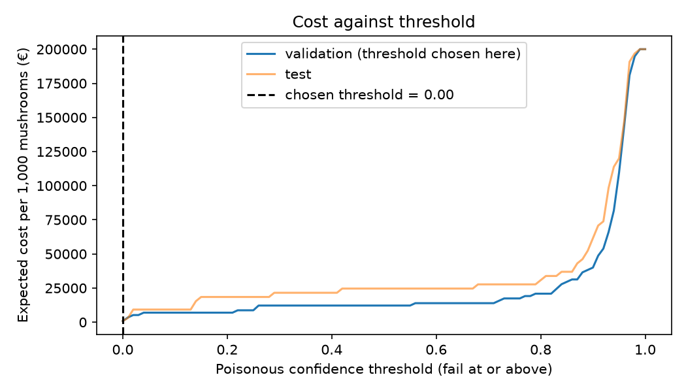

# Assignment 2 Report

- **Name**: Javier López-Usero Fernández
- **Student ID**: 18633
- **Email**: jlopezusero.ieu2022@student.ie.edu
- **Group**: [BBADBA 5A | BBADBA 5B | PPLEDBA 5A | BDBA 3A]

## Business problem, and the cost of being wrong

**Decision supported:**
Who hasn't gone hiking in the mountains and found a perfect, round, chunky mushroom, just like the ones children draw, that looks as tasty as it is beautiful? And who hasn't wondered whether it is safe to take it home and cook it for lunch, or, better still, roast it on a camping stove that night? The mushroom kingdom is famously tricky: many species look delicious, yet a single bite is enough to send you to hospital.

I propose a quick, safe and easy way to settle that doubt. Anyone with a phone camera can download an app with the model embedded, photograph the mushroom they want to eat, and get an instant answer. When the model is in doubt, an expert is brought into the loop to double-check that the mushroom is not poisonous.

**Positive class:** Poisonous-mushroom.

| Outcome | What happens in practice | Cost (€ per mushroom) |
|---|---|---|
| True positive (poisonous, thrown away) | Someone is prevented from eating a poisonous mushroom | 0 |
| False negative (poisonous, eaten) | Possible death, and a lawsuit against the company | 1,000 |
| False positive (edible, thrown away) | A small loss: the mushroom has to be replaced | 10 |
| True negative (edible, eaten) | A satisfied customer | 0 |
| Sent to a person for review | An expert checks the mushroom and feeds the newly labelled photo back into training, so the model keeps being finetuned | 3 |

**Why the two errors cost different amounts:**
A false positive is undesirable, but in this problem a person should only be allowed to eat a mushroom when the model is almost certain (although full certainty is never achievable). Throwing away an edible mushroom costs little, while eating a poisonous one costs a great deal.

I set the cost of throwing away an edible mushroom at 1 €, an estimate of the average supermarket price of edible mushrooms, so the cost of replacing one is about 1 €. I set the cost of eating a poisonous mushroom at 1,000 times that, to reflect how different the two outcomes are. A person who eats a poisonous mushroom and falls ill can rightly file a lawsuit against us, and may need treatment with advanced medical equipment that we, as a company, might have to cover as well.

## Dataset

- **Roboflow Universe:** workspace `jamurdetection`, project `jamur-detection`, **version 2**
- **Link:** https://universe.roboflow.com/jamurdetection/jamur-detection/dataset/2
- **Task:** object detection, 2 classes: `Edible-mushroom`, `Poisonous-mushroom`
- **Used as published** (downloaded directly, not forked).

**What one image represents:**
One image usually shows a mushroom on a typical forest floor of leaves, sticks, rocks and bugs.

**Why this dataset serves the problem:**
This dataset fits the problem well because it was gathered the same way users are expected to take their photos: as sharp and close-up as possible, so that the system can correctly decide whether the mushroom is safe to eat.

## What the dataset's composition implies

| Split | Images | Edible instances | Poisonous instances | Median box area (% of image) |
|---|---|---|---|---|
| Train | 694 | 1,553 | 830 | 9.7 % |
| Validation | 98 | 296 | 115 | 7.2 % |
| Test | 50 | 121 | 65 | 8.5 % |

- Train images are augmented by Roboflow (2 outputs per source image: flips and crop), so the 694 train images come from about 347 originals. Validation and test are not augmented.
- Box size: 10 % of boxes cover less than 1.9 % of the image, and 10 % cover more than 44.9 %.

**What this implies:**
The classes are noticeably imbalanced, with about 2 edible mushrooms for every poisonous one, but there are still enough instances of each class for precision and recall to be meaningful. The test set, however, is too small: 50 images are not enough to tell whether the poisonous filter really works. The dataset should be extended in the future with photos taken by customers, to make the model more precise.

## Finetuning and baselines

**Where and how I trained:** GitHub Actions (`.github/workflows/train.yml`), CPU-only runner, `yolo11n` from the COCO-pretrained checkpoint, 30 epochs, image size 640, seed 0, all other settings Ultralytics defaults. Training took about 1 h 30 min.

**Why detection with yolo11n:**
I used detection rather than classification because one image often contains several mushrooms. A classifier would give the whole image a single label, whereas a detector treats each mushroom independently. The dataset on Roboflow is also labelled with boxes, so it is meant to be used as a detection project. Finally, the instructions require at least three classes for classification, and this dataset has two.

Results on the same test split:

| Model | mAP50 | mAP50-95 | € per 1,000 mushrooms at the chosen threshold |
|---|---|---|---|
| Finetuned yolo11n | 0.956 | 0.828 | 3,077 |
| COCO yolo11n zero-shot | 0.000 | 0.000 | 200,000 |
| Trivial: predict nothing | 0.000 | 0.000 | 200,000 |

The COCO model has no mushroom class, so it cannot score on our classes. It put a box on 19.9 % of the test mushrooms (37 of 186), mostly labelled as donut (18), vase (8) and banana (5).

**Interpretation:**
The finetuned model consistently outperforms both baselines, because the false-negative cost is so high that it quickly outweighs every other cost. A random-guessing model would be far too expensive, because 50 % of the time it would be killing people. The COCO yolo11n zero-shot model only detected 20 % of the mushrooms and labelled the rest wrongly, so its answers cannot be trusted. In euros, the finetuned model is by far the most efficient: about 3,000 € against 200,000 € for the others, thanks to the absence of false negatives.

## Per-class evaluation and failure modes

| Class | Precision | Recall | AP50 | AP50-95 |
|---|---|---|---|---|
| Edible-mushroom | 0.910 | 0.884 | 0.951 | 0.858 |
| Poisonous-mushroom (positive) | 0.941 | 0.877 | 0.961 | 0.798 |
| All (mean) | | | 0.956 | 0.828 |

Confusion matrix on the test split (confidence 0.25; rows = predicted, columns = true):

| Predicted ↓ / True → | Edible | Poisonous | Background |
|---|---|---|---|
| Edible | 112 | 0 | 20 |
| Poisonous | 0 | 61 | 9 |
| Background (missed) | 9 | 4 | — |

**Which class carries the headline number:**
Poisonous mushrooms carry the headline number, since they are the most important ones to detect: never letting a poisonous mushroom through as edible is key to the business. High recall and high precision matter here so that, above all, nobody wrongly eats a poisonous mushroom.

**Where the model fails:**
The model fails if the false-negative cost is set too high, because that raises the bar a mushroom must clear to be classified as edible. Even when the model is more than 99 % sure, the mushroom can still be sent for review, because that costs less than killing a person.

## Cost matrix and operating point

**Costs:** see the table in the first section. **Base rate assumed:** 20 % of the mushrooms brought for checking are poisonous.

**Unit of decision:** one mushroom. Its score is the model's highest *Poisonous* confidence on a box overlapping it (IoU ≥ 0.5), or 0 if there is none. At threshold *t*, a mushroom fails (thrown away) if its score is ≥ *t* and passes (eaten) otherwise. Costs per 1,000 mushrooms are rates within each true class, reweighted to the assumed base rate.

**How the threshold was chosen:** swept *t* from 0 to 1 in steps of 0.01 on the **validation** split and took the minimum; the cost reported below is on the **test** split, so it is not tuned on the data it is reported on.

| | Value |
|---|---|
| Chosen threshold | 0.01 |
| Test cost at that threshold (€ per 1,000) | 3,077 |
| Test FN / FP at that threshold | 1 of 65 poisonous / 0 of 121 edible |

**Assumption that would most change the answer:**
I assumed the threshold at 0.01 because I think being 99.99 % sure that a mushroom is not poisonous is as sure as you can get. If you keep adding zeros to be virtually 100 % sure that a mushroom is safe, the model simply sends every mushroom to the expert to avoid the false-negative cost. The expert then becomes the bottleneck, and the project stops being a detector and becomes a communication channel between the expert and the user.

## What a person still has to check

| | Value |
|---|---|
| Lower threshold (PASS below) | 0.00 |
| Upper threshold (FAIL at or above) | 0.02 |
| Share sent to review | 80.9 % |
| Mushrooms checked per day (assumed) | 500 |
| Reviews per day | 405 |
| Minutes per review (assumed) | 2 |
| Reviewers needed (8 h/day each) | 1.69 |

**Is that realistic?**
Yes: one full-time reviewer plus one half-time reviewer can cover every mushroom sent for review. That is acceptable because they are only needed until the model has absorbed enough of the experts' knowledge, through the reviewed photos fed back into training, to replace them. The 80.9 % share sent for review will keep falling as more correctly identified edible mushrooms clear the safety threshold.

Priced against the alternatives (test split, € per 1,000 mushrooms):

| Policy | € per 1,000 | Share reviewed | Reviewers needed |
|---|---|---|---|
| Do nothing (everything eaten) | 200,000 | 0 % | 0 |
| A person checks everything | 3,000 | 100 % | 2.08 |
| Model decides alone (t = 0.01) | 3,077 | 0 % | 0 |
| **Model + human review (0.00 – 0.02)** | **2,428** | 80.9 % | 1.69 |

**Recommendation:**
I would deploy the model together with the experts, and give the mycologist community free use of the app so they can contribute their own photos. Combining their photos with the experts' knowledge, at 500 photos a day we would have a database of 15,000 photos within a month, which is enough to train a better model. As it stands, the model makes sure you don't get poisoned, but it sends too many cases to the expert. With a steep learning curve, though, it could become a free, real-time detector within a few months, solving a problem for many people.

## Limitations & next steps

The two main limitations I found were class imbalance and the scarcity of photos. Because there are so few samples, the test set is very small and the model could not be assessed properly, and the class imbalance tilted the model towards non-poisonous mushrooms.

To address these issues, I would release a free app backed by experts who classify the mushrooms in real time, and build a dataset from it, which would solve the scarcity. Class imbalance can only be solved with stratified splits, which is what was done here to keep the class ratios the same across splits.

## Generative AI use disclosure

I used Claude (Anthropic) through Claude Code to suggest candidate datasets, to write the code (`train.py`, `costing.py`, `app.py`, `.github/workflows/train.yml`), to build this report's template and fill in its numbers from the training outputs, and to correct the grammar and formatting of my text. The problem framing, the cost figures and base rate, the choice of thresholds and review capacity, and all analysis and conclusions in this report are my own.
